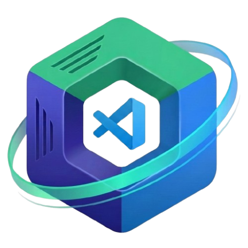

<div align="center">



# Fast Compose Preview

**Instant Jetpack Compose previews in VS Code. No compiler, no build, no waiting.**

Renders the previews of the open Kotlin file as you type, powered by
[Fast Compose](https://github.com/fast-compose/fast-compose).

[](https://marketplace.visualstudio.com/items?itemName=fast-compose.fast-compose-preview)
[](https://open-vsx.org/extension/fast-compose/fast-compose-preview)
[](https://central.sonatype.com/namespace/io.github.fast-compose)
[](LICENSE)


</div>

---

## Install

In VS Code: **Extensions** (Ctrl+Shift+X), search for **Fast Compose Preview** and install it, or get it from the
[VS Code Marketplace](https://marketplace.visualstudio.com/items?itemName=fast-compose.fast-compose-preview) or
[Open VSX](https://open-vsx.org/extension/fast-compose/fast-compose-preview). Then open a Kotlin file with preview
functions and click **Preview** above a `@Preview` function, or **Open Preview to the Side** in the editor's title
bar, or run **Fast Compose: Open Preview to the Side** from the Command Palette.

## Features

- Preview panel beside the editor. Its editor group is locked when more than one group is open, so files opened while
  the preview is focused open in another group.
- Follows the active Kotlin editor and its unsaved text. Selecting another file shows that file's previews, or none;
  a previous file's preview is never kept.
- **Preview** above every `@Preview` function opens the preview and scrolls to that function's preview.
- Files without previews cost nothing: the file is checked for preview functions first (comments, strings and imports
  don't count), and nothing is parsed or rendered until it has one.
- Each preview gets its own frame at a device size, scaled to fit the panel with the device's aspect ratio. Previews
  without `widthDp`/`heightDp` wrap their content up to that size. Scaling changes the density, so text stays sharp
  and clicks land correctly. Previews are centered and the list scrolls both ways.
- Bar below the previews:
  - **Device**: Phone (411 × 891 dp, default), Foldable (673 × 841 dp), Tablet (1280 × 800 dp) or Desktop
    (1920 × 1080 dp).
  - **Logs** shows or hides the logs pane, and counts its lines, in red when there are errors.
  - **Refresh** (icon) rebuilds the preview, reading the file, the files it uses and its resources again.
  - **Report Issue** (icon) opens a new GitHub issue for the Fast Compose engine (rendering, unsupported APIs,
    errors) or the extension, prefilled with the extension, engine, VS Code and OS versions. No code is sent.
  - **Zoom**: − and +, and a menu with Fit (default), 50 %, 75 %, 100 % and 150 %; Ctrl + mouse wheel also zooms.
  - Device, zoom and whether the logs are shown are saved per workspace. In a narrow panel the device's size is left
    out.
- Refresh and Report Issue are also in the panel's title bar.
- Crashes never leave an empty panel: after an uncaught error the webview is loaded again and shows the crash in the
  logs without rendering previews, until the file is edited, Refresh is pressed or another file is opened. If that
  crashes too, the error shows as plain text.
- Logs pane for parse errors, runtime errors and `println` output; clicking a line opens it. Lines about other files
  the preview uses are behind an **Other files** toggle, and clicking one opens that file.
- Composables, classes and values from other workspace files (see [Other files](#other-files)).
- Images and strings from `R` and `Res` (see [Resources](#resources)).
- Network images (`AsyncImage`) through Coil, downloaded by the extension, since many image servers refuse the
  webview's own requests, and cached on disk (up to 100 MB) in the extension's storage folder.
- Runs only while visible: a hidden panel gets no edits or file changes, and catches up when shown again. Closing it
  stops everything; only the **Preview** links stay.
- Shown again after VS Code restarts when it was open. Follows VS Code's light or dark theme.

## Other files

A preview can use top-level functions, classes, objects and properties declared in other files, e.g. `AppTheme` from
`ui/theme/Theme.kt`. Names are looked up as Kotlin does: explicit imports, then the file's package, then star imports.

- **Modules:** every folder with a `build.gradle` or `build.gradle.kts` file, outside `build/` folders. A module's
  dependencies are the `project(":…")` and `projects.…` references in its build file, matched to folders through the
  `include` and `projectDir` lines of the settings files. Build and settings files are read again when they change.
- **Where:** the package's folder under the previewed file's own source root and its module's shared source sets
  (`commonMain`, `main`), then under the shared source sets of the modules it depends on, directly or not, nearest
  first, then of the other modules, since dependencies may come from a convention plugin. Without a matching layout,
  folders next to the previewed file are used.
- **Which file:** the first one declaring the name; a declaration with a body wins over one without. Private
  declarations are skipped.
- **`expect` / `actual`:** for an `expect` declaration, the `actual` is taken from the same module's other source sets:
  `jvmMain` or `desktopMain` first, then `androidMain`, then the rest, with iOS, JS, Wasm and native last. The `expect`
  is then blanked out of its file, line positions kept, so previews see only the `actual`.
- **Reading:** files are read when a lookup needs them, with unsaved editor text, and cached until they change.
- **Changes:** editing a file the preview looked into, or adding, removing or moving Kotlin files, rebuilds the
  preview 300 ms after the last change. Nothing rebuilds while the preview is hidden.
- **Project or library:** a package belongs to the project when one of those source roots has a folder for it; names
  from other packages are library names, never looked up or reported.
- Files must be in a folder matching their package. Library code is never read; it comes from bindings.

## Resources

Previews read resources from the Gradle source set layout of the previewed file:

| Kind | Folder |
|---|---|
| Compose Multiplatform `Res` | `src/<sourceSet>/composeResources`, e.g. `shared/src/commonMain/composeResources` |
| Android `R` | `src/<sourceSet>/res`, e.g. `app/src/main/res` |

- **Order:** the file's own source set, then the shared source sets (`commonMain`, `main`) of the other modules, those
  it depends on first (see [Other files](#other-files)), then its module's shared source sets. The first folder with a
  match wins.
- **Lookup by name:** `R.string.title` and `Res.string.title` find the same name.
- **Reading:** only `drawable`, `mipmap`, `values`, `font` and `files` folders are listed, and a file is read only when
  a preview needs it, then cached (up to 16 MB per folder). Unsaved edits of open files, such as `strings.xml`, show
  right away.
- **Changes:** a changed file refreshes only its folder. Nothing refreshes while the preview is hidden.
- Library resources from AARs and `build/` folders are not read.

## Compose

The panel is a webview running Fast Compose's Kotlin/Wasm build with Compose Multiplatform, Material 3 and Coil,
matching the versions Fast Compose is built with. It needs no JDK, Android SDK or Gradle sync.

| Folder | What it is |
|---|---|
| `src` | The extension (TypeScript): the preview panel, following the editor, reading workspace files |
| `webview` | The panel's content (Kotlin/Wasm): Fast Compose and the preview UI, built with Gradle |

The extension sends the active file's text to the webview, which renders it. The webview asks the extension for other
files, folders, resources and network images, to open files, copy text and save its settings. The extension reports
changed Kotlin, resource and Gradle files to it.

## Run

```bash
cd webview
./gradlew installWebview
```

```bash
npm install
npm run compile
```

- `installWebview` builds the webview and copies it into `dist/webview`, which the panel loads. `installDevWebview`
  copies the development build instead: faster to build, larger, for trying changes.
- `localEngine` (optional): a local Fast Compose engine checkout, e.g. `-PlocalEngine=../../fast-compose`, built
  instead of the Maven Central release (`fastCompose` in `webview/gradle/libs.versions.toml`), to try engine changes
  before they are released.
- Press F5 in VS Code with this folder open to run the extension in a new window.

## Release

The version is `version` in `package.json`; its change notes are its `## <version>` section of `CHANGELOG.md`.

```bash
npm run package
```

- `package` writes `fast-compose-preview-<version>.vsix`, to install from disk with **Extensions → … → Install from
  VSIX**. Build the webview with `installWebview` first.

On GitHub, `.github/workflows/build.yml` builds the webview and packages the extension for pushes and pull requests,
and a `v<version>` tag publishes it to the VS Code Marketplace and Open VSX and creates a GitHub release with the
`.vsix`. It needs:

- A **Trusted Publishing** policy on the `fast-compose` publisher at
  [marketplace.visualstudio.com/manage](https://marketplace.visualstudio.com/manage): repository owner
  `fast-compose`, repository `vscode-extension`, workflow `build.yml`, no environment. The Marketplace then accepts
  the workflow's GitHub token; no secret is needed.
- `OVSX_PAT`: a repository secret with an Open VSX access token (Publishing only). The `fast-compose` namespace is
  created once with `npx ovsx create-namespace fast-compose -p <token>`.

## Requirements

- VS Code 1.100 or newer
- JDK 21 and Node.js 22 for building

## Third-party libraries

Bundled in the webview, all under the Apache 2.0 license: [Fast Compose](https://github.com/fast-compose/fast-compose),
[Compose Multiplatform](https://github.com/JetBrains/compose-multiplatform),
[Material 3 for Compose](https://github.com/JetBrains/compose-multiplatform), [Coil](https://github.com/coil-kt/coil)
and [Okio](https://github.com/square/okio).

## License

Apache 2.0
